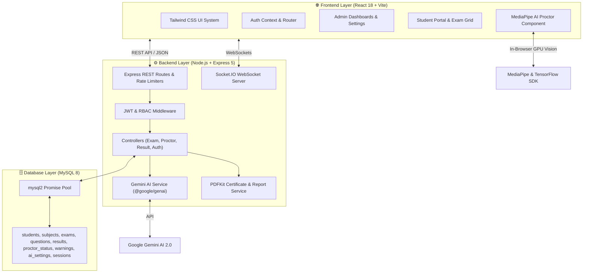
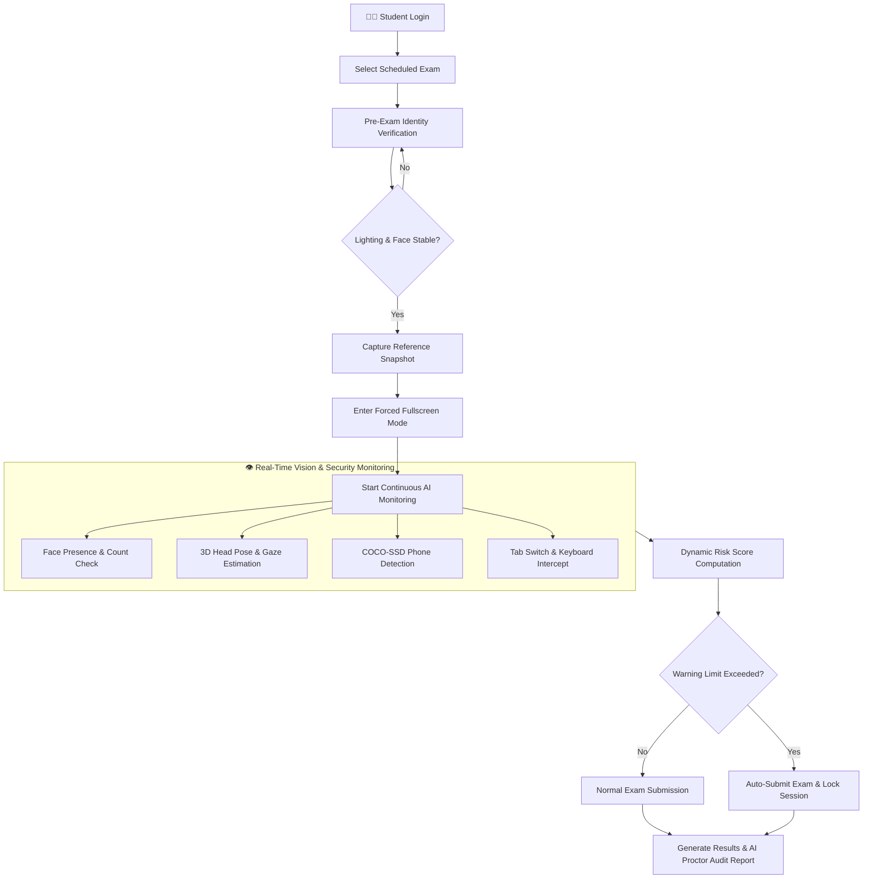
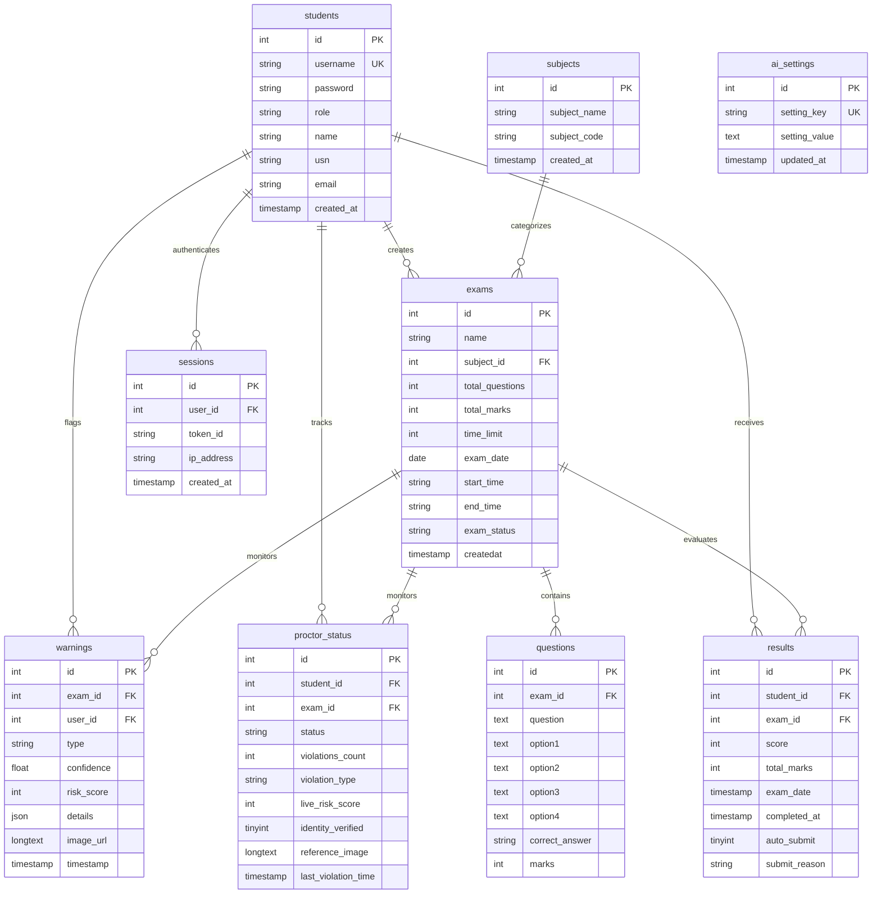

<div align="center">

# 🎓 Smart AI Online Examination System
### Enterprise-Grade Secure Online Examination Platform with AI Proctoring & Intelligent Question Generation

<br>


</div>

---

# 📖 Table of Contents

1. [Executive Summary & Purpose](#-1-executive-summary--purpose)
2. [Key System Features](#-2-key-system-features)
   - [AI Proctoring & Vision Engine](#-21-ai-proctoring--vision-engine)
   - [Google Gemini 2.0 Question Generator](#-22-google-gemini-20-question-generator)
   - [Admin Management & Analytics Portal](#-23-admin-management--analytics-portal)
   - [Student Examination Portal](#-24-student-examination-portal)
   - [Automated PDF Certificate & Report Engine](#-25-automated-pdf-certificate--report-engine)
3. [System Architecture & Diagrams](#-3-system-architecture--diagrams)
   - [Component & Layer Architecture](#-31-component--layer-architecture)
   - [Proctoring & Exam Workflow](#-32-proctoring--exam-workflow)
   - [Database Entity-Relationship (ER) Diagram](#-33-database-entity-relationship-er-diagram)
4. [Technology Stack](#-4-technology-stack)
5. [Database Schema & Data Model](#-5-database-schema--data-model)
6. [REST API & Route Specifications](#-6-rest-api--route-specifications)
7. [Security & Anti-Cheating Framework](#-7-security--anti-cheating-framework)
8. [Installation & Setup Guide](#-8-installation--setup-guide)
9. [Automation Scripts Reference](#-9-automation-scripts-reference)
10. [Default Credentials](#-10-default-credentials)
11. [License & Author](#-11-license--author)

---

# 📖 1. Executive Summary & Purpose

The **Smart AI Online Examination System** (Codebase: `DNSPostProject`) is an enterprise-ready, intelligent online assessment platform engineered for educational institutions, universities, and technical certification bodies to conduct tamper-proof remote examinations.

By bridging **React 18**, **Express 5**, **MySQL 8**, **Google Gemini 2.0 AI**, and **MediaPipe Face Landmarker AI**, the system eliminates physical proctoring bottlenecks while guaranteeing assessment integrity through automated computer vision proctoring and dynamic risk score computation.

---

# ✨ 2. Key System Features

## 🎥 2.1. AI Proctoring & Vision Engine
* **Pre-Exam Facial Identity Verification**: Runs a 1.5-second face stability and room lighting assessment before allowing student entry to an examination. Captures a baseline reference facial snapshot.
* **3D Head Pose Tracking**: Calculates candidate **Yaw** (head turning), **Pitch** (up/down tilting), and **Roll** angles in real time using 3D facial landmarks.
* **Iris Gaze & Eye Aspect Ratio (EAR) Estimation**: Tracks horizontal iris displacement to detect side glances (`LOOKING_LEFT`, `LOOKING_RIGHT`) and eye closure duration (`EAR < 0.14`).
* **Face Absence & Multi-Face Detection**: Triggers warnings if candidate face is absent for longer than configurable thresholds (default 5s) or if multiple faces enter the webcam view.
* **Mobile Phone Detection**: Asynchronously executes TensorFlow COCO-SSD (`lite_mobilenet_v2`) to detect mobile devices in the webcam frame.
* **Dynamic Risk Score Engine (0–100)**: Evaluates cumulative threat levels (**LOW**, **MODERATE**, **HIGH**, **CRITICAL**), records webcam screenshot evidence to MySQL, issues real-time warnings, and auto-submits the exam upon limit breach.

## 🤖 2.2. Google Gemini 2.0 Question Generator
* **PDF Syllabus / Document Parsing**: Extracts raw text from uploaded PDF study material using `pdfjs-dist`.
* **Instant MCQ Generation**: Generates formatted JSON array of multiple-choice questions with 4 options and correct answers.
* **Multi-Model Fallback Cascade**: Gracefully cascades across `gemini-flash-latest`, `gemini-flash-lite-latest`, `gemini-2.0-flash-lite`, `gemini-2.0-flash`, `gemini-3.6-flash`, and `gemini-3.5-flash`.
* **Exponential Backoff Retry**: Handles 503 service unavailable and 429 quota exhaustion errors seamlessly.

## 👨‍💼 2.3. Admin Management & Analytics Portal
* **Course & Subject CRUD**: Manage subjects and subject codes.
* **Exam Management**: Configure exam window date, time limit, question weights, total marks, and publish status.
* **Student Enrollment & Bulk Import**: Import student rosters via Excel (`.xlsx`, `.xls`) files.
* **Proctor Incident & Evidence Auditor**: Review live proctoring statuses, candidate incident histories, and full-resolution screenshot evidence for any student session.
* **Configurable AI Thresholds Panel**: Fine-tune risk weights, head turn degrees, warning limits, and face missing timeouts.
* **System Factory Reset**: Complete dataset cleanup mechanism for fresh exam cycles.

## 👨‍🎓 2.4. Student Examination Portal
* **Secure JWT Login & Identity Modal**: Password-protected entry with face match verification.
* **Synchronized Timer & Auto-Save**: Real-time timer synced with server clock, preventing timer manipulation.
* **Results & Breakdown**: View instant score, score breakdown percentage, correct response key, and rank.

## 📑 2.5. Automated PDF Certificate & Report Engine
* **Result Scorecards & Certificates**: Automated PDF certificate generation for passed exams using `pdfkit`.
* **Hall Tickets / Admit Cards**: Generates downloadable hall tickets for registered students.
* **Formal Proctor Audit Reports**: Generates detailed institutional proctoring audit reports containing candidate details, risk scores, incident logs, and webcam image evidence.

---

# 🏗️ 3. System Architecture & Diagrams

## 3.1. Component & Layer Architecture



## 3.2. Proctoring & Exam Workflow



## 3.3. Database Entity-Relationship (ER) Diagram



---

# 💻 4. Technology Stack

| Layer | Technology | Package Version | Function |
| :--- | :--- | :--- | :--- |
| **Frontend Framework** | React | `^18.3.1` | Declarative UI components |
| **Build Tool** | Vite | `^6.0.1` | HMR dev server & production bundling |
| **Router** | React Router DOM | `^6.28.0` | Client-side page navigation |
| **AI Computer Vision** | MediaPipe Vision | `^0.10.21` | GPU-accelerated face landmarker |
| **Object Detection** | TensorFlow.js + COCO-SSD | `^4.22.0` / `^2.2.3` | Mobile phone & prohibited device detection |
| **Backend Runtime** | Node.js | `>=18.0.0` | Server JavaScript engine |
| **Backend Framework** | Express | `^5.2.1` | REST API routes & middleware pipeline |
| **Database** | MySQL 8 (`mysql2/promise`) | `^3.23.2` | Relational database management |
| **Generative AI** | Google Gemini AI (`@google/genai`)| `^1.46.0` | AI question generation from PDF |
| **Authentication** | JWT (`jsonwebtoken`) + `bcrypt` | `^9.0.2` / `^5.1.1` | Token security & password hashing |
| **Input Validation** | Zod Schema Validation | `^3.24.1` | Strict API payload enforcement |
| **PDF Engine** | PDFKit | `^0.18.0` | Dynamic PDF generation for reports & hall tickets |
| **WebSockets** | Socket.IO | `^4.8.3` | Real-time security alerts & status updates |

---

# 🗄️ 5. Database Schema & Data Model

Defined in [`database.sql`](file:///d:/Projects/ExamPagluuu%20V%203.1.0/DNSPostProject/database/database.sql):

1. **`students`**: User account credentials and profile details (`role`: `'Admin'` or `'Student'`).
2. **`subjects`**: Academic subjects catalog (`subject_name`, `subject_code`).
3. **`exams`**: Exam configuration schedules, duration, and status (`published`).
4. **`questions`**: Multiple choice question repository linked to `exams`.
5. **`results`**: Candidate exam scores, submission timestamps, and auto-submit reasons (`NORMAL`, `AI_PROCTOR_SECURITY`).
6. **`proctor_status`**: Live proctoring status tracking per candidate session.
7. **`warnings`**: Log of proctoring violations with risk scores, JSON metadata, and Base64 JPEG webcam evidence snapshots.
8. **`ai_settings`**: Global key-value database for proctoring risk weight thresholds.
9. **`sessions`**: Active JWT session tokens for tracking user logins.

---

# ⚡ 6. REST API & Route Specifications

### 🔑 Authentication Routes (`/api`)
* `POST /api/login` - User login & JWT issuance
* `GET /api/verify-session` - Token session validation
* `POST /api/logout` - Session invalidation
* `GET /api/profile` - Authenticated user details

### 📚 Subject & Exam Management Routes (`/api/subjects`, `/api/exams`)
* `GET /api/subjects` - List all subjects
* `POST /api/subjects` - Create new subject (Admin)
* `GET /api/exams` - List all exams
* `POST /api/exams` - Schedule new exam (Admin)
* `POST /api/questions/generate-ai` - PDF upload & Gemini AI question generation (Admin)
* `POST /api/questions/upload/:exam_id` - Bulk upload Excel questions (Admin)

### 👨‍🎓 Student & Result Routes (`/api/students`, `/api/results`)
* `GET /api/students` - Student list (Admin)
* `POST /api/students/upload` - Bulk student Excel import (Admin)
* `POST /api/submit` - Exam submission & auto-grading
* `GET /api/my-results` - Student result history
* `GET /api/rank-list/:exam_id` - Exam leaderboard rank list
* `GET /api/result-pdf/:result_id` - Download PDF certificate
* `GET /api/hall-ticket/:exam_id` - Download PDF admit card

### 👁️ Proctoring Routes (`/api/proctor`)
* `POST /api/proctor-status` - Update live proctor status
* `POST /api/flag-violation` - Record violation & evidence screenshot
* `POST /api/proctor/verify-identity` - Pre-exam identity verification
* `GET /api/incidents/:exam_id` - Fetch violation history for exam (Admin)
* `GET /api/proctor/settings` - Read AI risk threshold settings
* `POST /api/proctor/settings` - Save AI risk threshold settings (Admin)
* `GET /api/proctor/report-pdf/:result_id` - Download formal PDF proctoring audit report

---

# 🛡️ 7. Security & Anti-Cheating Framework

1. **Forced Fullscreen**: Requires candidate full screen. Tracks exit events.
2. **Visibility & Tab Switching**: Triggers security violation when candidate switches tabs or minimizes window.
3. **Keyboard Interception**: Intercepts `F12`, `Ctrl+C`, `Ctrl+V`, `Ctrl+A`, `Ctrl+S`, `Ctrl+P`, `Ctrl+U`, `Ctrl+Shift+I`, `Ctrl+Shift+J`.
4. **Context Menu Block**: Disables right-click and context menu inspection.
5. **Express Security & Rate Limiting**: Enforces rate limiting on `/api/login` (max 20 attempts) and `/api` (max 300 requests/15m). Configures security headers (`nosniff`, `X-Frame-Options: DENY`, `X-XSS-Protection`).
6. **JWT Cookies & RBAC**: Secures API routes via JSON Web Tokens with Role-Based Access Control (`Admin` vs `Student`).

---

# ⚡ 8. Installation & Setup Guide

### 1. System Requirements
* **Node.js**: `>= 18.0.0`
* **MySQL Database**: `8.0+`
* **Webcam & Microphone**: Required for proctoring

### 2. Environment Setup
Create a `.env` file in `DNSPostProject/`:
```env
PORT=5000
DB_HOST=localhost
DB_PORT=3306
DB_NAME=online_exam_system
DB_USER=root
DB_PASSWORD=your_mysql_password
JWT_SECRET=your_super_secret_jwt_key
GEMINI_API_KEY=your_google_gemini_api_key
```

### 3. Database Initialization
```bash
mysql -u root -p < DNSPostProject/database/database.sql
```

### 4. Running the Application
```bash
# Navigate to project core
cd DNSPostProject

# Install Backend Dependencies
cd backend && npm install

# Install Frontend Dependencies
cd ../frontend && npm install
cd ..

# Start Express Backend Server (Terminal 1)
npm run dev:backend

# Start React Frontend Dev Server (Terminal 2)
npm run dev:frontend
```

---

# 🛠️ 9. Automation Scripts Reference

The workspace includes pre-configured automation scripts located at the project root:

* [`Start_Project.bat`](file:///d:/Projects/ExamPagluuu%20V%203.1.0/Start_Project.bat): Checks MySQL status, validates environment, installs dependencies, and launches dev servers.
* [`Health_Check.bat`](file:///d:/Projects/ExamPagluuu%20V%203.1.0/Health_Check.bat): Diagnostic tool verifying Node, MySQL connection, ports (5000 & 5173), and `.env` parameters.
* [`Restart_Project.bat`](file:///d:/Projects/ExamPagluuu%20V%203.1.0/Restart_Project.bat): Terminates background Node/Vite processes and restarts services cleanly.
* [`Stop_Project.bat`](file:///d:/Projects/ExamPagluuu%20V%203.1.0/Stop_Project.bat): Gracefully kills all running background servers.
* [`Install_MySQL.bat`](file:///d:/Projects/ExamPagluuu%20V%203.1.0/DNSPostProject/Install_MySQL.bat): Script to set up local MySQL 8 database service.
* [`Check_Database.bat`](file:///d:/Projects/ExamPagluuu%20V%203.1.0/DNSPostProject/Check_Database.bat): Diagnostics for database connection and schema tables.

---

# 🔑 10. Default Credentials

| Account Role | Username | Password | USN / ID | Email |
| :--- | :--- | :--- | :--- | :--- |
| **Administrator** | `admin` | `admin123` | `ADMIN001` | `admin@agmr.edu` |
| **Student Account 1** | `student1` | `pass1` | `1AG21CS001` | `student1@agmr.edu` |
| **Student Account 2** | `student2` | `pass2` | `1AG21CS002` | `student2@agmr.edu` |

---

# 📜 11. License & Author

* **Developer**: Sayed Zaid Kazi
* **Organization**: AGMR College of Engineering / Smart AI Examination Systems
* **License**: Licensed under the [ISC License](LICENSE).
