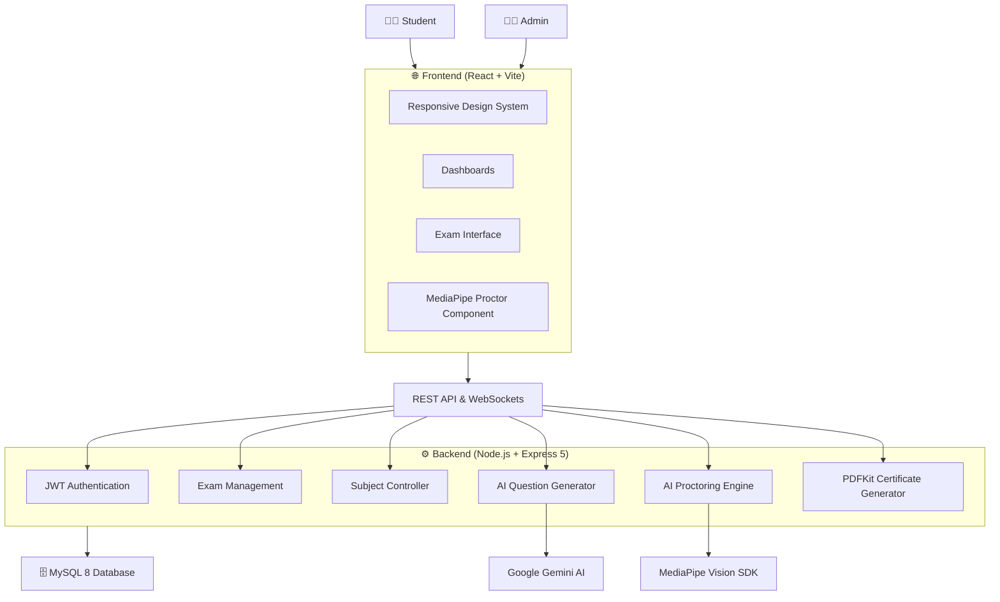
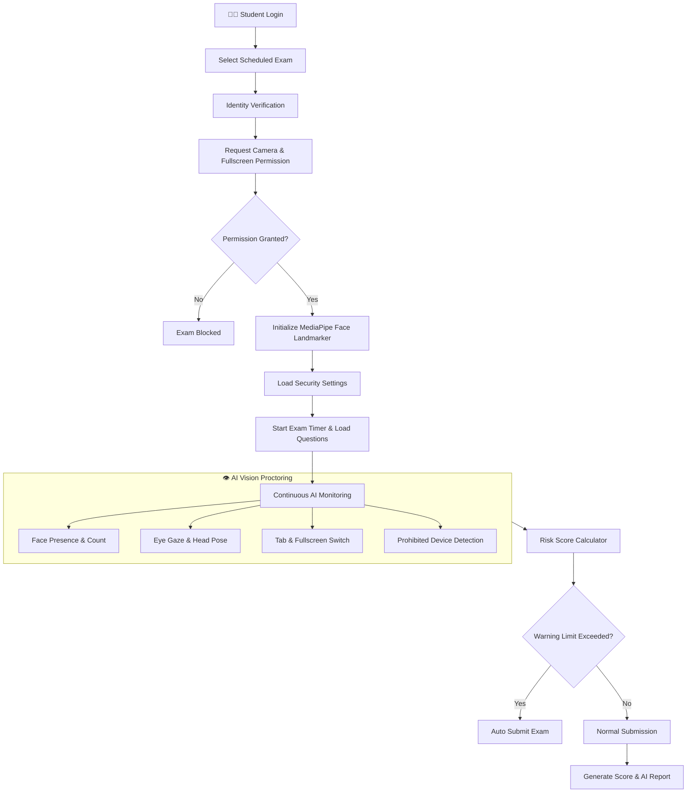
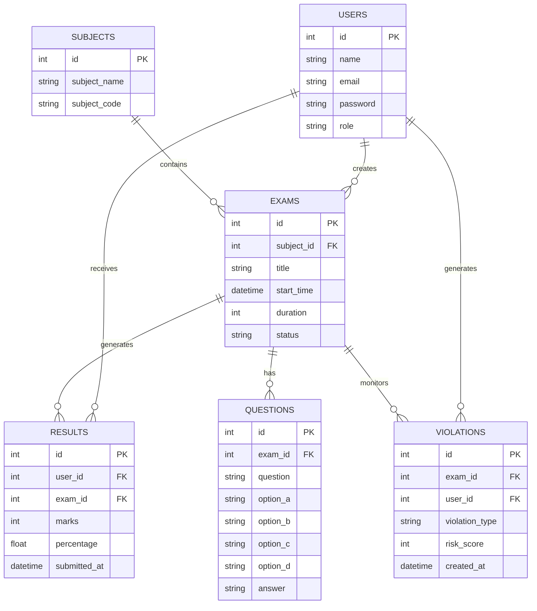

<div align="center">

# 🎓 Smart AI Online Examination System

### 🚀 Next-Generation Secure Online Examination Platform with AI Proctoring & Intelligent Question Generation

<br>


<br><br>

### 🛡️ Smart • Secure • AI-Powered • Modern

> **An enterprise-grade AI-powered online examination platform featuring real-time vision proctoring, Gemini AI question paper generation, and automated security reports.**

</div>

---

# 📖 Overview

The **Smart AI Online Examination System** is a production-ready, intelligent examination platform designed for universities, colleges, and educational institutes to conduct tamper-proof online assessments.

The system combines **React 18**, **Express 5 Node.js**, **MySQL 8**, **JWT Authentication**, **Google Gemini 2.0 AI**, and **MediaPipe Face Landmarker** to deliver an end-to-end examination ecosystem.

### ✨ Highlights

- 🤖 **AI Question Generation**: Instant MCQ paper creation from PDF/Text using Google Gemini AI (`@google/genai`).
- 🎥 **AI Vision Proctoring**: Real-time webcam monitoring via MediaPipe Face Landmarker AI.
- 👁️ **Gaze & Head Tracking**: Continuous tracking of eye direction, head rotation, and face count.
- 📱 **Object & Phone Detection**: Live detection of mobile devices and prohibited items during exams.
- 📊 **Dynamic Risk Score Engine**: Automated violation tracking, immediate warnings, and auto-submission on limit breach.
- 🔐 **Enterprise Security**: Role-Based Access Control (RBAC), JWT cookies/headers, Zod input validation, rate limiting, and SQL injection protection.
- 📑 **Instant Results & PDF Certificates**: Automated evaluation, rank lists, subject analytics, and PDF certificates via PDFKit.

---

# ✨ Features

## 👨‍💼 Admin Module

- 🔐 Secure Admin Authentication & Role Management
- 📊 Real-time System Dashboard & Exam Analytics
- 📚 Subject & Course Management
- 👨‍🎓 Student Enrollment & Bulk Excel Import
- 📝 Gemini AI Question Paper Generation
- 📖 Question Bank CRUD Operations
- 📅 Exam Scheduling & Configuration
- 🚀 One-Click Exam Publishing
- 📄 AI Proctoring Reports & Screenshot Evidence Logs
- ⚙️ Custom AI Risk Threshold Settings

## 👨‍🎓 Student Module

- 🔑 Secure JWT Authentication & Profile Management
- 🏠 Personalized Student Portal & Exam Schedule
- 👤 AI Facial Identity Verification before entry
- 🎥 Automated MediaPipe Proctoring Setup
- ⏱️ Synchronized Exam Timer & Auto-Save
- 📊 Instant Result Display & Score Breakdown
- 📈 Downloadable Result PDF & Hall Tickets

---

# 🏗️ System Architecture

```
                   +--------------------+
                   |     React + Vite   |
                   +---------+----------+
                             |
                     REST API (Express 5)
                             |
         +-------------------+------------------+
         |                                      |
 Authentication                    AI Proctoring Engine
 (JWT + bcrypt)          (MediaPipe + Computer Vision)
         |                                      |
         +-------------------+------------------+
                             |
                          MySQL 8
```

### 🔀 System Workflow



---

# 📊 AI Proctoring Workflow



---

# 🗄️ Database ER Diagram



---

# 📂 Project Directory Structure

```
DNSPostProject/
├── backend/                 # Express 5 Node.js Server Architecture
│   ├── config/             # DB (mysql2/promise) & JWT configurations
│   ├── controllers/        # Express Controllers (Auth, Exam, Proctor, Result)
│   ├── middleware/         # Auth, Zod Validation, Error Handling
│   ├── models/             # MySQL 8 Data Access Objects
│   ├── routes/             # API Route Definitions
│   ├── services/           # Gemini AI & PDFKit Services
│   ├── utils/              # Zod validation schemas
│   └── server.js           # Express + Socket.IO Server Entry Point
├── frontend/                # React 18 + Vite Frontend Application
│   ├── src/
│   │   ├── components/     # MediaPipeProctor, Navbar, Sidebar, Toast
│   │   ├── context/        # Auth Context Management
│   │   ├── pages/          # Login, Dashboards, Exam, Results, AISettings
│   │   ├── services/       # API Axios Client & Interceptors
│   │   ├── App.jsx         # React Router v6 Routes
│   │   └── main.jsx        # App Entry Point
│   ├── index.html
│   └── vite.config.js
├── database/
│   └── database.sql        # Complete MySQL 8 Schema & Seed Script
└── docs/                   # Full Technical Documentation
```

---

# 💻 Technology Stack

| Component | Technology | Version |
| :--- | :--- | :--- |
| **Frontend Framework** | React | `^18.3.1` |
| **Frontend Build Tool** | Vite | `^6.0.1` |
| **AI Computer Vision** | MediaPipe Face Landmarker | `^0.10.21` |
| **Backend Runtime** | Node.js | `>=18.0.0` |
| **Backend Framework** | Express | `^5.2.1` |
| **Database** | MySQL 8 (`mysql2/promise`) | `^3.23.2` |
| **AI Engine** | Google Gemini AI (`@google/genai`) | `^1.46.0` |
| **Authentication** | JWT (`jsonwebtoken`) + `bcrypt` | `^9.0.2` / `^5.1.1` |
| **Validation** | Zod Schema Validation | `^3.24.1` |
| **PDF Generation** | PDFKit | `^0.18.0` |

---

# ⚡ Quick Start & Installation

### 1. Prerequisites
- **Node.js** >= 18.0.0
- **MySQL 8** Database Server running locally or on a server

### 2. Environment Configuration
Create a `.env` file inside `DNSPostProject/` directory based on `.env.example`:

```env
PORT=5000
DB_HOST=localhost
DB_PORT=3306
DB_NAME=online_exam_system
DB_USER=root
DB_PASSWORD=your_mysql_password
JWT_SECRET=your_super_secret_jwt_key
GEMINI_API_KEY=your_google_gemini_api_key
```

### 3. Database Setup
Import the database schema:
```bash
mysql -u root -p < DNSPostProject/database/database.sql
```

### 4. Installation & Launch

```bash
# Clone the repository
git clone https://github.com/zaid46kazi-wq/Smart-AI-Online-Examination-Portal.git
cd Smart-AI-Online-Examination-Portal/DNSPostProject

# Install Backend & Frontend Dependencies
cd backend && npm install
cd ../frontend && npm install
cd ..

# Run Express Backend (Terminal 1)
npm run dev:backend

# Run React Frontend (Terminal 2)
npm run dev:frontend
```

---

# 📜 License & Author

Developed by **Sayed Zaid Kazi**.  
Licensed under the [ISC License](LICENSE).
