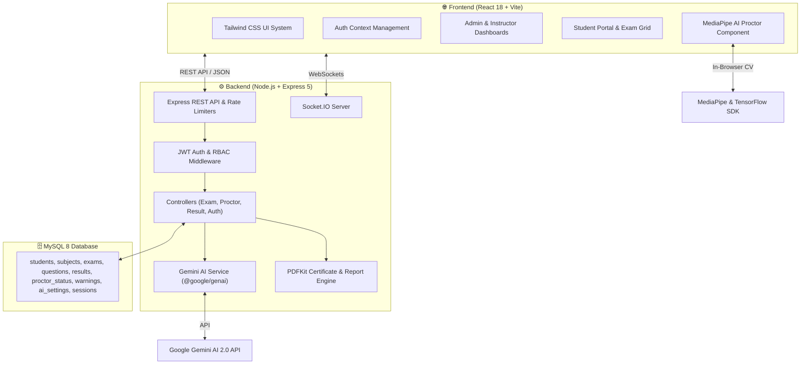
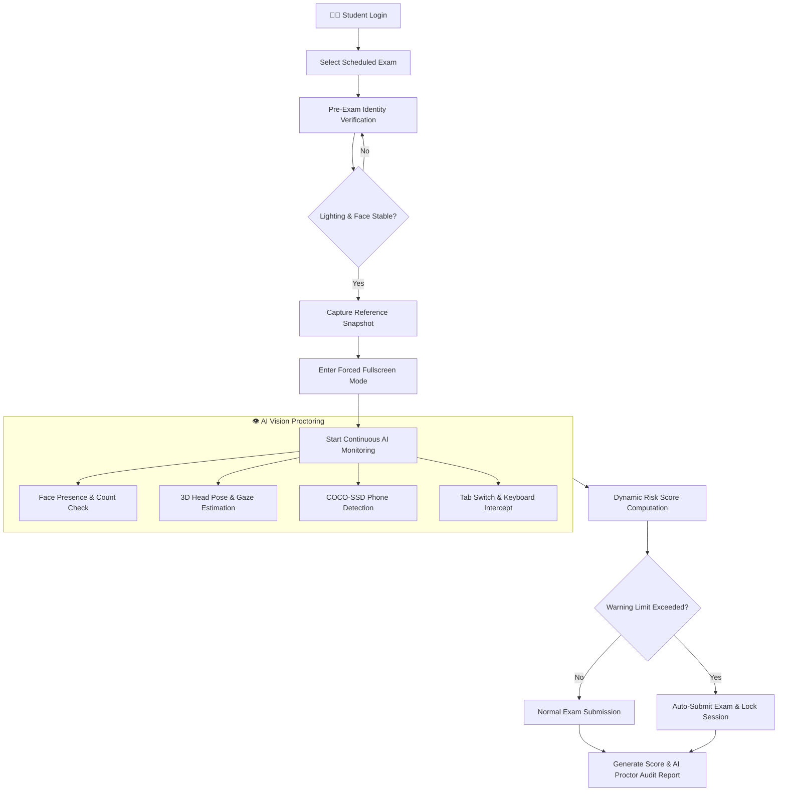
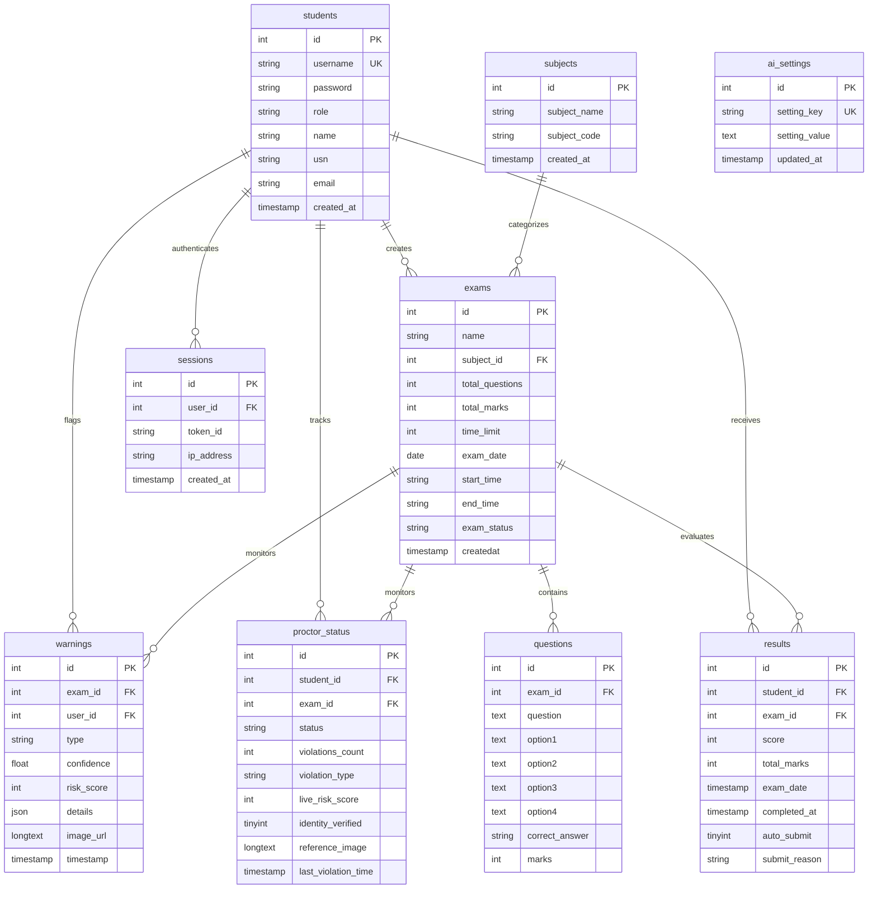

<div align="center">

# 🎓 Smart AI Online Examination System (v3.1.0)

### 🚀 Next-Generation Enterprise Secure Online Examination Platform with AI Vision Proctoring & Intelligent Question Generation

<br>


<br>

### 🛡️ Smart • Secure • AI-Powered • Enterprise Ready

> **An enterprise-grade online examination platform featuring real-time AI vision proctoring (MediaPipe 3D Head Pose & Gaze + COCO-SSD Phone Detection), Google Gemini AI question paper generation, automated risk score engines, and instant PDF audit reports.**

</div>

---

# 📖 Overview

The **Smart AI Online Examination System** (Version `3.1.0`) is a production-ready, intelligent assessment ecosystem designed for colleges, universities, and educational institutions to conduct tamper-proof online exams.

The system combines **React 18**, **Express 5**, **MySQL 8**, **JWT Authentication**, **Google Gemini 2.0 AI**, **MediaPipe Face Landmarker**, and **TensorFlow COCO-SSD** to deliver an end-to-end examination platform with zero server-side vision overhead.

### ✨ Highlights & What's New in v3.1.0

- 🤖 **Google Gemini 2.0 AI Question Generator**: Instant MCQ paper creation from PDF syllabi with multi-model fallback cascades (`gemini-flash-latest`, `gemini-2.0-flash`, `gemini-3.6-flash`).
- 🎥 **MediaPipe 3D Vision Proctoring**: Real-time webcam tracking of 3D Head Pose (**Yaw**, **Pitch**, **Roll**), Eye Aspect Ratio (EAR), and Iris Gaze direction.
- 📱 **Mobile Phone & Prohibited Device Detection**: Real-time object detection via TensorFlow COCO-SSD (`lite_mobilenet_v2`).
- 👤 **Pre-Exam Facial Identity Verification**: Pre-test face stability and lighting brightness validation before exam entry.
- 📊 **Dynamic Risk Score Engine (0–100)**: Real-time threat classification (**LOW**, **MODERATE**, **HIGH**, **CRITICAL**), webcam evidence snapshot logging to MySQL, and auto-submission on limit breach.
- ⚙️ **Configurable AI Thresholds Panel**: Admin settings interface for fine-tuning warning limits, face timeout durations, gaze sensitivity, and custom risk weights.
- 🔐 **Anti-Cheating Security Suite**: Forced full-screen enforcement, window blur/tab switch tracking, right-click disabling, and keyboard shortcut suppression (`F12`, `Ctrl+C/V/A/S/P/U`).
- 📑 **Instant Results & PDF Reports**: Automated evaluation, rank leaderboards, PDF certificates, hall tickets, and formal institutional PDF proctor audit reports.

---

# 🏗️ System Architecture



---

# 📊 AI Proctoring & Security Workflow



---

# 🗄️ Database Entity-Relationship (ER) Diagram



---

# 📂 Project Directory Structure

```
DNSPostProject/
├── backend/                 # Express 5 Node.js Server Architecture
│   ├── config/             # Database (mysql2/promise) & JWT configurations
│   ├── controllers/        # Express Controllers (Auth, Exam, Proctor, Result, Analytics)
│   ├── middleware/         # JWT Auth, Zod Validation, Error Handling, Rate Limiter
│   ├── models/             # MySQL 8 Data Access Objects
│   ├── routes/             # API Route Definitions
│   ├── services/           # Gemini AI, PDFKit & Email Services
│   ├── utils/              # Zod validation schemas
│   └── server.js           # Express + Socket.IO Server Entry Point
├── frontend/                # React 18 + Vite Frontend Application
│   ├── src/
│   │   ├── components/     # MediaPipeProctor, Navbar, Sidebar, Toast, ErrorBoundary
│   │   ├── context/        # Auth Context Management
│   │   ├── pages/          # Login, AdminDashboard, StudentDashboard, ExamPage, CreateExam, ResultView, AISettings
│   │   ├── services/       # Axios API Client & Interceptors
│   │   ├── App.jsx         # React Router v6 Routes
│   │   └── main.jsx        # Frontend Entry Point
│   ├── index.html
│   └── vite.config.js
├── database/
│   ├── database.sql        # MySQL 8 Schema & Seed Script
│   ├── schema.sql          # Core table DDL
│   └── init_db.js          # Database setup utility script
└── docs/                   # Full Technical Documentation
```

---

# 💻 Technology Stack

| Component | Technology | Version | Description |
| :--- | :--- | :--- | :--- |
| **Frontend Framework** | React | `^18.3.1` | Declarative component UI |
| **Frontend Build Tool** | Vite | `^6.0.1` | Fast HMR dev server & production bundler |
| **AI Computer Vision** | MediaPipe Face Landmarker | `^0.10.21` | GPU-accelerated 3D face tracking |
| **Object Detection** | TensorFlow COCO-SSD | `^2.2.3` / `^4.22.0` | In-browser mobile phone detection |
| **Backend Runtime** | Node.js | `>=18.0.0` | Server execution runtime |
| **Backend Framework** | Express | `^5.2.1` | REST API routes & middleware |
| **Database** | MySQL 8 (`mysql2/promise`) | `^3.23.2` | Relational database engine |
| **AI Engine** | Google Gemini AI (`@google/genai`) | `^1.46.0` | MCQ question paper generator |
| **Authentication** | JWT (`jsonwebtoken`) + `bcrypt` | `^9.0.2` / `^5.1.1` | Session security & password hashing |
| **Validation** | Zod Schema Validation | `^3.24.1` | API request validation |
| **PDF Generation** | PDFKit | `^0.18.0` | Certificates, hall tickets, & proctor reports |
| **WebSockets** | Socket.IO | `^4.8.3` | Real-time security alerts & updates |

---

# ⚡ Quick Start & Installation Guide

### 1. Prerequisites
- **Node.js**: `>= 18.0.0`
- **MySQL 8**: Running locally or on a remote database server

### 2. Environment Configuration
Create `.env` file inside `DNSPostProject/` directory:

```env
PORT=5000
DB_HOST=localhost
DB_PORT=3306
DB_NAME=online_exam_system
DB_USER=root
DB_PASSWORD=your_mysql_password
JWT_SECRET=your_super_secret_jwt_key
GEMINI_API_KEY=your_google_gemini_api_key
```

### 3. Database Setup
Import the complete MySQL 8 schema:
```bash
mysql -u root -p < DNSPostProject/database/database.sql
```

### 4. Installation & Launch Commands

```bash
# Navigate to project directory
cd DNSPostProject

# Install Backend & Frontend Dependencies
cd backend && npm install
cd ../frontend && npm install
cd ..

# Run Express Backend (Terminal 1 - http://localhost:5000)
npm run dev:backend

# Run React Frontend (Terminal 2 - http://localhost:5173)
npm run dev:frontend
```

---

# 🛠️ One-Click Automation Scripts

The project includes batch scripts located at the project root:

- **[`Start_Project.bat`](file:///d:/Projects/ExamPagluuu%20V%203.1.0/Start_Project.bat)**: Checks MySQL, validates configuration, installs missing packages, and starts servers.
- **[`Health_Check.bat`](file:///d:/Projects/ExamPagluuu%20V%203.1.0/Health_Check.bat)**: Runs diagnostics on Node.js, MySQL connection, ports (5000 & 5173), and `.env` setup.
- **[`Restart_Project.bat`](file:///d:/Projects/ExamPagluuu%20V%203.1.0/Restart_Project.bat)**: Kills background Node/Vite processes and cleanly restarts.
- **[`Stop_Project.bat`](file:///d:/Projects/ExamPagluuu%20V%203.1.0/Stop_Project.bat)**: Terminates all running project background processes.

---

# 🔑 Default Test Accounts

| Role | Username | Password | USN / ID | Email |
| :--- | :--- | :--- | :--- | :--- |
| **Administrator** | `admin` | `admin123` | `ADMIN001` | `admin@agmr.edu` |
| **Student 1** | `student1` | `pass1` | `1AG21CS001` | `student1@agmr.edu` |
| **Student 2** | `student2` | `pass2` | `1AG21CS002` | `student2@agmr.edu` |

---

# 📜 License & Author

Developed by **Sayed Zaid Kazi**.  
Licensed under the [ISC License](LICENSE).
