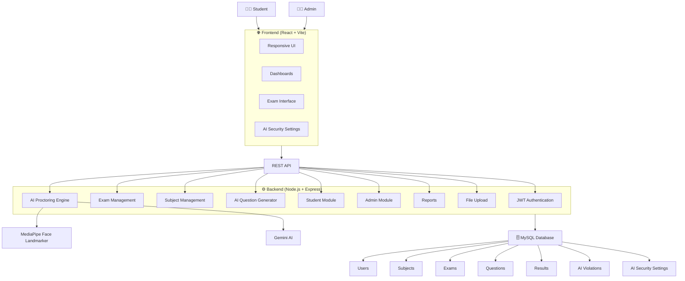
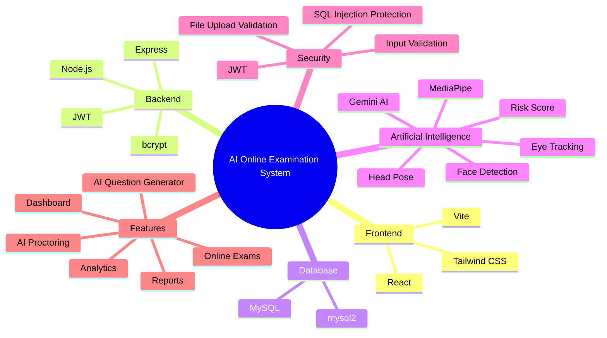
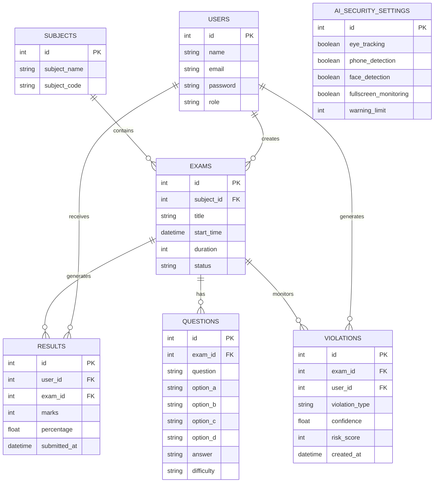
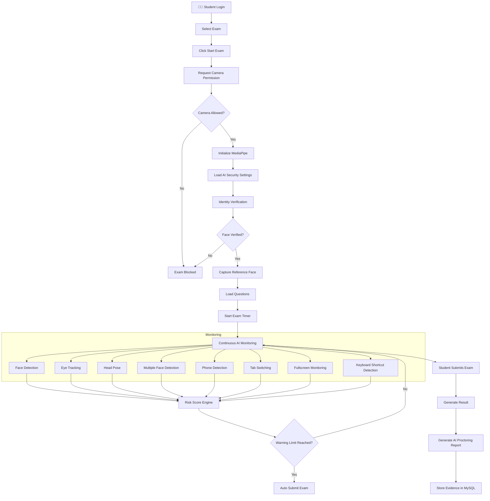

<div align="center">

# 🎓 AI-Powered Online Examination System

### 🚀 A Next-Generation Secure Online Examination Platform with AI Proctoring


<br>


<br><br>

### 🛡️ Smart • Secure • AI-Powered • Modern

> **An enterprise-grade AI-powered online examination platform with real-time proctoring, intelligent question generation, and secure exam management.**

</div>

---

# 📖 Overview

The **AI-Powered Online Examination System** is a next-generation intelligent examination platform designed to conduct secure online examinations using Artificial Intelligence and Computer Vision.

The system combines **React**, **Node.js**, **Express**, **MySQL**, **JWT Authentication**, **Gemini AI**, and **MediaPipe Face Landmarker** to provide a complete AI-powered examination ecosystem.

### ✨ Highlights

- 🤖 AI Question Generation using Gemini AI
- 🎥 AI Proctoring with MediaPipe
- 👁️ Eye Tracking
- 😊 Face Detection & Identity Verification
- 📱 Mobile Phone Detection
- 👥 Multiple Face Detection
- 📊 AI Risk Score Engine
- ⚡ Real-Time Monitoring
- 🔐 JWT Authentication
- 📈 Analytics Dashboard
- 🗄️ MySQL Database
- 📑 AI Proctoring Reports

---

# ✨ Features

## 👨‍💼 Admin Module

- 🔐 Secure Admin Authentication
- 📊 Dashboard Analytics
- 📚 Subject Management
- 👨‍🎓 Student Management
- 📥 Bulk Student Import
- 📝 AI Question Generation
- 📖 Question Bank Management
- 📅 Exam Scheduling
- 🚀 Publish Exams
- 📈 Result Analytics
- 🤖 AI Security Configuration
- 📄 AI Proctoring Reports
- ⚙️ System Configuration

---

## 👨‍🎓 Student Module

- 🔑 Secure Login
- 🏠 Personalized Dashboard
- 📅 View Available Exams
- 👤 AI Identity Verification
- 🎥 AI Proctoring
- ⏱️ Automatic Exam Timer
- 📊 Instant Results
- 📈 Performance Reports
- 👤 Profile Management

---

# 🤖 AI Features

## 🧠 AI Question Generator

Generate intelligent examination questions using **Google Gemini AI**.

### Features

- ✅ Automatic Question Generation
- ✅ Multiple Difficulty Levels
- ✅ Subject-wise Questions
- ✅ Bloom's Taxonomy Support
- ✅ AI Prompt Engineering
- ✅ MySQL Integration
- ✅ Automatic Formatting
- ✅ Error Handling
- ✅ Secure API Communication

---

## 🎥 AI Proctoring System

The AI continuously monitors candidates throughout the examination.

### AI Modules

- 👤 Face Detection
- 🆔 Identity Verification
- 👀 Eye Tracking
- 🎯 Head Pose Detection
- 👥 Multiple Face Detection
- 📱 Mobile Phone Detection
- 🖥️ Fullscreen Monitoring
- 🔄 Tab Switching Detection
- ⌨️ Keyboard Shortcut Detection
- 📸 Screenshot Evidence
- ⚠️ Warning System
- 📊 AI Risk Score Engine
- 📄 AI Violation Reports
- ⛔ Auto Submit

---

## 🔒 Security Features

- JWT Authentication
- bcrypt Password Encryption
- Role-Based Access Control
- Protected Routes
- SQL Injection Protection
- Input Validation
- Secure File Uploads
- Environment Variables
- API Security

---

# 🏗 System Architecture

```
                   +--------------------+
                   |     React + Vite   |
                   +---------+----------+
                             |
                             |
                    REST API (Express)
                             |
         +-------------------+------------------+
         |                                      |
 Authentication                    AI Proctoring Engine
 (JWT + bcrypt)          (MediaPipe + Computer Vision)
         |                                      |
         +-------------------+------------------+
                             |
                          MySQL 8
```


---

# 💻 Technology Stack

| Layer | Technology |
|---------|------------|
| Frontend | React + Vite |
| Backend | Node.js + Express |
| Database | MySQL 8 |
| Authentication | JWT + bcrypt |
| AI | Gemini API |
| Computer Vision | MediaPipe Face Landmarker |
| Validation | Zod |
| Uploads | Multer |
| ORM/Driver | mysql2 |
| Styling | Tailwind CSS |

---

---
# 📁 Project Structure

```
AI-Online-Exam-System/

├── frontend/
├── backend/
├── database/
├── uploads/
├── public/
├── docs/
├── scripts/
├── README.md
```

---

# 🚀 Installation

## Clone Repository

```bash
git clone https://github.com/yourusername/AI-Online-Exam-System.git

cd AI-Online-Exam-System
```

---

## Backend

```bash
cd backend

npm install

npm run dev
```

---

## Frontend

```bash
cd frontend

npm install

npm run dev
```
## 🚀 Technology Stack


## Database


```

Create MySQL Database

```sql
CREATE DATABASE online_exam;
```

Import SQL

```
database.sql
```

---

# 🔑 Environment Variables

Backend

```
PORT=

JWT_SECRET=

DB_HOST=

DB_PORT=

DB_USER=

DB_PASSWORD=

DB_NAME=

GEMINI_API_KEY=
```
## 🗄️ Database ER Diagram


---

# 🎯 AI Exam Flow

```
Student Login

↓

Select Exam

↓

Identity Verification

↓

Camera Permission

↓

AI Initialization

↓

Face Verification

↓

Questions Loaded

↓

Exam Timer Starts

↓

Continuous AI Monitoring

↓

Warnings

↓

Auto Submit (if required)

↓

Results

↓

AI Report
```
## 📊 AI Proctoring Workflow


---

# 📊 AI Monitoring

During the exam the system monitors

- Face Presence
- Identity Verification
- Eye Tracking
- Head Pose
- Mobile Phone
- Multiple Faces
- Tab Switching
- Fullscreen Exit
- Keyboard Shortcuts
- Risk Score

---

# 📸 Screenshots

Add screenshots here

- Login
- Dashboard
- Admin Panel
- Student Dashboard
- AI Proctoring
- AI Question Generator
- Results
- Reports

---

# 📈 Future Improvements

- AI Voice Monitoring
- Browser Lockdown
- Live Invigilator Dashboard
- Multi-language Support
- Cloud Deployment
- AI Behaviour Analytics

---

# 🤝 Contributing

Contributions are welcome!

Feel free to fork this repository and submit a Pull Request.

---

# ⭐ Support

If you like this project,

⭐ Star this repository

🍴 Fork it

📢 Share it

---

# 📜 License

This project is licensed under the MIT License.

---

# 👨‍💻 Developer

Sayed Zaid Kazi
Developed with ❤️ using modern web technologies.

---

<div align="center">

## ⭐ If you found this project useful, don't forget to Star the Repository ⭐

**Building the Future of Secure Online Examinations with Artificial Intelligence**

</div>
